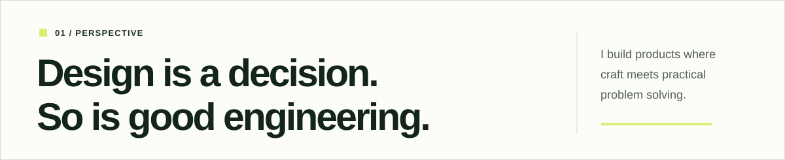
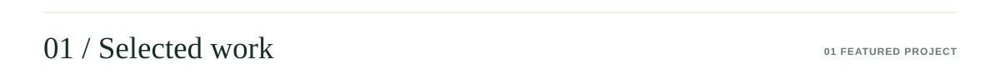
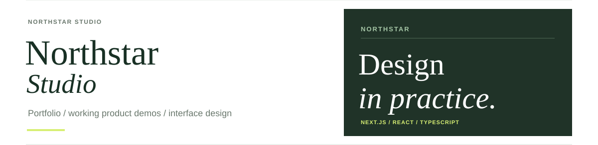
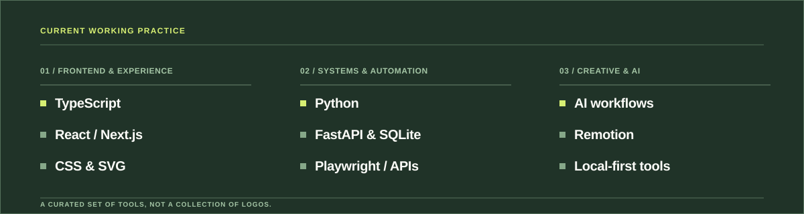

<!-- AKOPYAN0 / FOREST & CITRON — an original editorial profile. -->

  

  
<strong>Independent software maker</strong> — web experiences, automation and AI systems.

  
<a href="https://northstar-portfolio-studio.vercel.app/">Northstar Studio</a> &nbsp; / &nbsp; <a href="https://github.com/Akopyan0?tab=repositories">Explore repositories</a>

 

A curated space for the things I design, ship and improve. From digital experiences to automation, my work is grounded in clarity, usefulness and craft.

 

**Northstar Studio** — a Next.js / TypeScript portfolio with interactive product demonstrations. [Source code](https://github.com/Akopyan0/Northstar---Portfolio) · [Live website](https://northstar-portfolio-studio.vercel.app/)

### Latest public projects

A live index of my latest public, non-fork repositories. The GitHub workflow automatically refreshes these custom SVG cards every day and can also be run manually. Public does not necessarily mean open-source licensed.

<!-- AUTO:PROJECTS_START -->
<table>
  <tbody>
    <tr>
      <td width="50%"></td>
      <td width="50%"></td>
    </tr>
  </tbody>
</table>
<!-- AUTO:PROJECTS_END -->

 

  
  

 

<!-- The SVG artwork is designed specifically for this profile. -->
