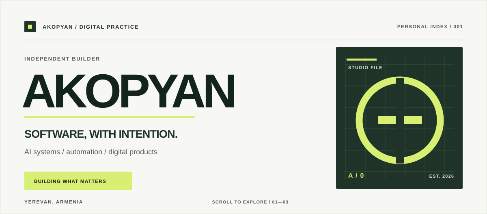
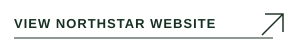
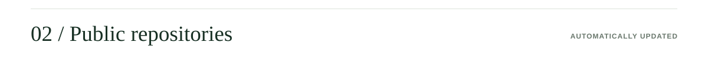
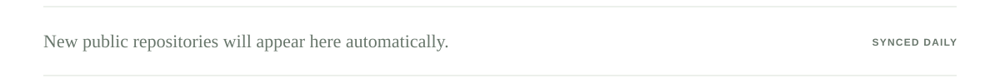
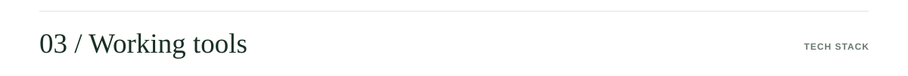
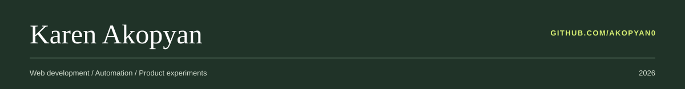

<!-- Profile artwork: Forest & Citron / editorial edition. -->

  

  
  

  

  

<!-- AUTO:PROJECTS_START -->

<!-- AUTO:PROJECTS_END -->

  
  

  

<!-- The public repositories section is maintained by a scheduled GitHub Action. -->
