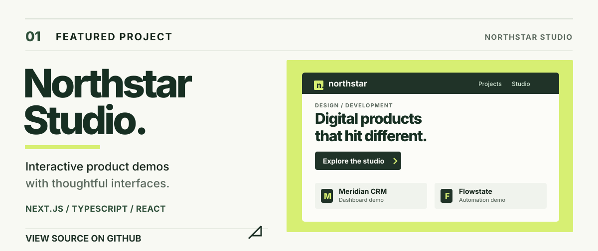
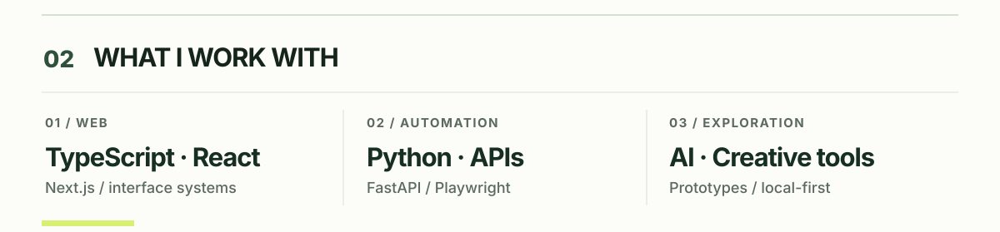
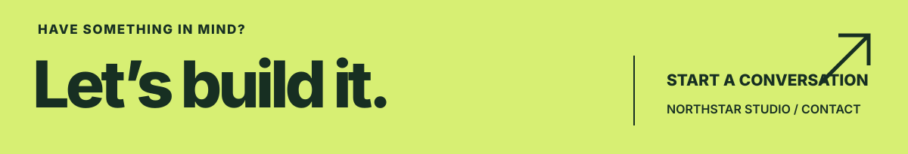

<!-- Original Forest & Citron portfolio identity. Art direction: no decorative widgets, emoji or fake statistics. -->

  

<!-- AUTO:PROJECTS_START -->

<!-- AUTO:PROJECTS_END -->

  

<!-- Public project cards are generated by GitHub Actions when new public repositories appear. -->
